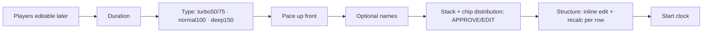

# Poker Night — Client Feedback Analysis (Round 1, October 2026)

**Written for:** the Poker Night engineering team and the project owner — the people who will schedule and implement the fixes. This is an **analysis deliverable**, not a set of applied changes. No application code was modified.

**Date:** 2026-10-11 · **Branch analysed:** `new-implementation` · **Engine:** `lib/utils/tournament_engine.dart` (3,322 lines)

> **How to read a citation.** `file:line` points at the exact code. Reproductions are inputs → observed output from the engine run in `docs/analysis/engine-scenarios.csv` (1,440 runs) via the throw-away harness `docs/analysis/scratch/scenario_matrix.dart`. Anything I could not confirm is marked **Unverified** with what would confirm it.

---

## 8.1 Executive summary

The 31 points collapse into **10 root causes**. Fixing these resolves the great majority of the feedback.

| # | Root cause | Drives points | Severity |
|---|---|---|---|
| **RC1** | **The blind ladder is filtered to the chips in play, then indexed with the *unfiltered* index — at *two* coupled sites.** The opening SB (`:2141`) and the whole ladder-walk cursor seed (`:2130-2131`, read at `:2188`/`:2217`) both use `startIndex` (an index into the *unfiltered* `validBlindLevels`) against the *filtered* `ladder`. When the smallest chip is ≥ 25 (a real home case with no "1" chips) the two lists diverge, so (a) the opening prints **SB > BB** and (b) **L1→L2 jumps ×6–×8** because L1's BB comes from the unfiltered table while L2 onward walks the filtered ladder from the wrong anchor. It is **not a one-line fix** — both the opening read and the cursor seed must be re-anchored. | 6, 7, 8, 20 | **P0** |
| **RC2** | **The engine has no "starting stack" input and no "tournament type / depth" input.** `TournamentParams` carries neither a `forceStack` nor a depth/style field. Depth is derived *only* from `pace` (or a duration formula). The host literally cannot type a stack or pick "normal = 100 BB" as a first-class choice. | 2, 3, 5, 13, 19 | **P0** |
| **RC3** | **There is no "stack first → approve → structure" pipeline.** Quick start generates and jumps straight to the live clock with no review at all; the group flow shows the stack only on a later review screen; the free tool shows the ladder first. The stack-and-chip-distribution step the client asks for as the *first* output does not exist as a gate. | 2, 3, 5, 19, 30 | **P0/P1** |
| **RC4** | **Recalculate regenerates from scratch; a host stack override is discarded.** `adjustStructure` lets a host set the stack on the review screen, but it does **not** re-scale blinds to keep depth, does **not** re-check the chip bank, and is **wiped** the next time `recalculateStructure` runs (which calls `generate()` fresh). Pins (edited *blind* rows) *are* preserved via `resolveAroundPins`; the *stack* is not. | 2, 19 | **P0** |
| **RC5** | **Rebuy close: suggested too early, and a manual close does not re-solve.** The auto-suggestion lands on **L2 in 235/288 (82%)** of rebuy runs — far earlier than the client's intent (rebuys to L4–L6). A manual close of 4/5/6 is *recorded* (`rebuysCloseLevel` updates) but the **stack and ladder are byte-identical to close 0** (base25 9p regular: 9950 & the same ladder for close 0/4/5/6), so the marker moves the ante start but does not re-solve the structure. | 2 | **P1** |
| **RC6** | **"Pace" and "tournament type" are the same axis in code.** The client treats depth (turbo/normal/deep stack) and level length (pace) as two separate questions. The engine folds them into one `PaceMode`. This is also why "No pace fits this night" fires: the pace recommendation is gated on `bankOk`, so a chip-bank shortfall is reported to the host as a *pace* problem. | 11, 14, 15 | **P1** |
| **RC7** | **The group "create tournament" wizard is the full 5-step C1 wizard, not a light event post.** It asks chip set, rebuys/add-ons and format/pace up front — everything the client wants deferred to "Create structure." | 1, 4, 5, 11, 12, 16 | **P1** |
| **RC8** | **The reference engines were never in this repo.** `research/structure_engine.js` (759 vectors) and `research/payouts_engine.js` (55 vectors) "could not be recovered" (`test/structure_vectors_test.dart:14-18`, `test/payouts_engine_test.dart:5-8`). Addendum 1 says they ship with the package and spec §A3 lists their SHA-256, so the owner can supply them. The Dart engine was **rebuilt from the prose spec** and is checked only by locally-authored property/identity tests. RC1/RC9/RC10 are exactly the classes of bug a real port-vs-reference diff would have caught. **Restoring the 759 + 55 vectors is a WP1 prerequisite.** | (all engine) | **P0 (process)** |
| **RC9** | **Stacks and opening blinds are not round home-game values.** For sets *with* a low chip, the engine returns stacks like 396, 597, 796 and openings 2/4, 3/6, 4/8 — and the rebuy reserve *shrinks* the stack as the field grows (box500 regular: 6p 2000 → 9p 1200 → 12p 1000; **rebuy 9p 396**). **712/1440 runs have a stack that is not a multiple of 25** (box500 326/480, demo 386/480). Home play wants round stacks (×25/×100) and a 25-based blind ladder when the chips allow. | 2, 7, 8, 13 | **P1** |
| **RC10** | **`feasible` is not a bank check.** `feasible` is set to `depthFeasible` (`:2488`,`:1885`) — "an opening pair was found" — and the real `count × draws ≤ owned` logic only appends a *warning string* (`:1944-1957`), never flipping `feasible`. So `feasible=true` while the night needs more chip value than the case holds in **456/1440 runs** (e.g. base25 9p deep rebuy: need **287,100** vs owned **252,500**). `paceOptions` then reports `bankOk: s.feasible` (`:3262`), i.e. a mislabeled signal. | 15, 20 | **P0** |

**Engine vector status.** The 759 + 55 reference vectors **do not exist** and cannot be run. The locally-authored suites that stand in for them **pass**: 215 tests green across `structure_vectors`, `payouts_engine`, `demo_night_vector`, `structure_integrity`, `engine_properties`, `ante_recommendation`, `rebuy_optimiser`, `chip_payability`, `breaks`, `addon_window`, `a1_addendum_corrections` (log: `docs/analysis/scratch/engine_tests.log`). **None of them asserts `sb < bb` per level** — which is why RC1 shipped green.

**Overall health of the creation flows.** No chip case is clean. Sets whose smallest chip is ≥ 25 (the client's real case) produce **SB > BB in every run** and ×6–×8 blind jumps; sets *with* a low chip avoid SB>BB but return **non-round, shrinking stacks** (396/597/796, openings 2/4 and 3/6) and still mis-report **bank feasibility** across all cases. Two of the three "flows" the client describes are not built as separate things (quick start has no review; group create is the heavy wizard); the stack-first pipeline is the single biggest missing piece.

**Top five P0s:** F6 (SB > BB **and** ×6–×8 steps), F20/RC10 (`feasible` is not a bank check — 456 runs claim a night the case cannot fund), F2 (stack not editable / no depth input), F19 (recalc destroys stack override), F6b (inflated 8,000–40,000 stacks). Runner-up P1s with the broadest blast radius: F32/RC9 (non-round shrinking stacks) and F33/RC5 (rebuy close suggested at L2, manual close ignored).

---

## 8.2 Repo map

| Area | Where |
|---|---|
| **Tech stack** | Flutter 3.38.9 (stable), Dart; Firebase (Auth/Firestore/Storage); OneSignal push; `go_router`; `provider`. Package `poker_night`. |
| **Build / run** | `flutter run -d chrome` (web), `flutter run` (device). Tests: `flutter test`. |
| **Structure engine** | `lib/utils/tournament_engine.dart` — entry `TournamentEngine.generate` (`:1438`), `paceOptions` (`:3232`), `resolveAroundPins` (`:3004`), `suggestRebuyClose`/`optimiseRebuyCloseLevel` (`:2944`,`:1097`). |
| **Payouts engine** | `lib/utils/payouts_engine.dart`, bridged by `lib/utils/payout_bridge.dart`. |
| **ICM** | `lib/utils/icm.dart`. |
| **Engine tests / "vectors"** | `test/structure_vectors_test.dart`, `test/payouts_engine_test.dart`, `test/engine_properties_test.dart`, `test/demo_night_vector_test.dart`, `test/structure_integrity_test.dart`. |
| **Quick game (C0)** | `lib/screens/tournament/quick_start_screen.dart`. |
| **Group create (C1 wizard)** | `lib/screens/tournament/create_tournament_screen.dart` (+ `lib/widgets/event_settings_form.dart`). |
| **Create structure / review (C2)** | `lib/screens/tournament/structure_review_screen.dart` (+ `lib/widgets/structure_editor.dart`). |
| **Live dashboard / clock** | `lib/screens/tournament/admin_dashboard_screen.dart`, `lib/screens/tournament/player_live_screen.dart`, `lib/widgets/app_timer.dart`, `tournament_timer_card.dart`, `svg_countdown_ring.dart`. |
| **Rebuy settlement (C6)** | `lib/screens/tournament/rebuy_settlement_screen.dart`. |
| **Chip set editor / presets / settings** | `lib/widgets/chip_set_editor.dart`, `lib/screens/shell/edit_chip_set_screen.dart`, `lib/screens/shell/presets_screen.dart`, `lib/screens/shell/settings_screen.dart`, `lib/models/tournament_preset.dart`, `lib/models/chip_palette.dart`. |
| **Free tools (E2/E3/E4)** | `lib/screens/public/tools_screen.dart` (blind generator, clock, ICM). |
| **Cash** | `lib/screens/cash/cash_game_screen.dart`. |
| **Voice/TTS** | `lib/utils/voice_service.dart`. |
| **Currency formatting** | `lib/utils/formatters.dart` (`currencySymbol`, `chips`, `moneyCents`). |
| **Logo** | `lib/widgets/brand_lockup.dart`; assets `assets/logo_<palette>.png`. |
| **Group switcher** | `lib/widgets/group_switcher.dart`, `lib/widgets/nav_drawer.dart`. |
| **State / models** | `provider`-based `AppProvider` split across `lib/providers/app_provider_*.dart`; structure held in `TournamentStructure`/`BlindLevel` (`lib/models/tournament.dart`), pins via `PinnedLevel` (`tournament_engine.dart:126`). **No model holds a persistent host "stack override".** |
| **`research/*.js`, `mockup/`** | **Absent.** Never recovered. The JS reference diff the brief asks for is therefore impossible. |

---

## 8.3 Flows: current vs target

### Quick game (C0) — `quick_start_screen.dart`

**Current**

No tournament-type card, no stack shown, **no review/approve step**, no inline level edit. `generate()` is called inside `_settings()` and the game goes straight to `startTournament()` (`quick_start_screen.dart:301-313`). Stack is never surfaced.

**Target**


### Group event (Create tournament) — `create_tournament_screen.dart`

**Current:** 5-step wizard `['… ', 'Chip set', 'Rebuys & add-ons', 'Format', 'Review & create']` (`:184-189`). Asks chip set, rebuy/add-on, format/pace while merely posting for RSVP.

**Target:** one light screen — buy-in · location · date/start · KO bounty y/n (+amount) · tournament type · rebuy type · on-time bonus % (with indicative chips) · **Post**. Nothing else.

### Create structure (close to the night) — currently `structure_review_screen.dart` reached from Configure

**Current:** pre-fills from confirmed/RSVP head-count (`app_provider_tournament.dart:1288-1296`); shows a review table with a late "Adjust starting stack" modal and a bottom "Recalculate" dialog. **Target:** opens on the invited/RSVP count → the shared **StructureBuilder** (stack first → approve → structure).

### Free tool → clock — `tools_screen.dart`

**Current:** blind generator calls `generate()` (`:406`,`:1467`) and renders the ladder; a "Use this structure" button (`:846`) and a `/tools/clock` route (`route_paths.dart:29`) exist, so an E2→E3 hand-off is present. **No stack-approve step** (same gap as quick start). **Target:** stack-first pipeline, then "Use this structure in the tournament clock?".

### Field-by-field: group event wizard

| Field | Current step | Target | Action |
|---|---|---|---|
| Buy-in | step 1 | event | keep |
| Location, date/start | step 1 | event | keep |
| KO bounty y/n (+amt) | step 1 | event | keep |
| Tournament type (turbo/normal/deep) | **not asked** | event | **add** |
| Rebuy type | step 2 | event (type only) | keep (slim) |
| On-time bonus % | event settings | event (+ chips) | keep + show chips |
| Chip set | **step "Chip set"** | **Create structure** | **move** |
| Rebuys close level / add-on sizing | step 2 | **Create structure** | **move** |
| Format + pace | **step "Format"** | type → event; pace → **Create structure** | **move/split** |
| Players / stack / distribution | — | **Create structure** | **add** |

---

## 8.4 Findings (one per client point; extra issues as X1…)

> Categories: **Bug** / **Spec gap** / **Change request** / **Conflict**. Severity P0–P3. Effort S (<0.5d) / M (0.5–2d) / L (>2d).

### F1: Three entry points exist but are not clearly three (client pt 1)
**Category:** Spec gap · **Severity:** P2 · **Effort:** M
**Expects:** three clearly distinct ways — quick game, group event, create structure.
**Now:** Quick game (`/quick`) and the group wizard exist; "create structure" is not a distinct, labelled entry — it is the review screen reached from Configure. Quick start also has *no review at all*, so it is not really the same pipeline as the other two.
**Where:** `quick_start_screen.dart`, `create_tournament_screen.dart`, `structure_review_screen.dart`.
**Fix:** make "Create structure" a first-class, named step; route all three through one **StructureBuilder**.
**Acceptance:** all three reachable and labelled; all three show stack-first. **Depends on:** F2, F19.

### F2: Starting stack cannot be set; no tournament-type input (pts 2, 3, 13, 19) — **P0**
**Category:** Bug + Conflict · **Severity:** P0 · **Effort:** L
**Spec refs:** §F1.5 ("engine proposes S; host does not type it") — this is the conflict; §A1 (every derived value overridable).
**Expects:** first output = starting stack (e.g. 2000 = 100 BB) + chip distribution, editable; tournament type chosen as turbo 50/75 · normal 100 · deep 150 BB.
**Now:** `TournamentParams` (`tournament.dart:260-302`) has **no stack field and no type/depth field**. A repo-wide search for `forceStack`/`stackOverride`/`stackOptions`/`smallOutStack` returns **nothing**. Depth is derived only from `pace` or a duration formula (`tournament_engine.dart:1540-1561`). Quick start exposes no stack control at all.
**Root cause:** confirmed — the engine's input contract omits both fields.
**Fix:** add `forceStack` and `targetDepthBB`/`style` to `TournamentParams`; thread a type selector into the UI; surface an editable stack + distribution before the ladder.
**Acceptance:** host can type a stack and pick a type; both reach `generate()`; T-new: "a forced stack is the stack returned."
**Tests:** engine unit (forced stack honoured), widget (stack field present in all three flows). **Depends on:** RC2.

### F3: Stack-first also missing in group generate (pt 3) — see F2/F19
**Category:** Spec gap · **Severity:** P1 · **Effort:** M. The group flow *does* show the stack, but only on the later review screen (`structure_review_screen.dart:673-674`), not as the first output. Fold into the StructureBuilder.

### F4: Group "create tournament" is too heavy (pt 4) — **RC7**
**Category:** Conflict · **Severity:** P1 · **Effort:** L
**Spec refs:** C1 5-step wizard; §A5 #10.
**Expects:** only buy-in · location · start · KO y/n · type · rebuy type · bonus %.
**Now:** 5-step wizard asks chip set, rebuys & add-ons, format/pace (`create_tournament_screen.dart:184-189`).
**Fix:** reduce the event post to the client's list; move chip set / rebuy sizing / pace to Create structure. Audit controls for ≥44 px and current-state clarity (T103).
**Acceptance:** event post has exactly the client's fields; everything else appears only in Create structure. **Conflict logged (8.5).**

### F5: Create structure should start from invited count, stack first (pt 5)
**Category:** Spec gap + Conflict · **Severity:** P1 · **Effort:** M
**Now:** Configure pre-fills from confirmed/RSVP (`app_provider_tournament.dart:1288-1296`), i.e. the *Going* count, not the *full invited* list; and stack is not first. **Fix:** suggest the invited count, then ask player count; run StructureBuilder stack-first. **Open question 6.**

### F6: Small blind > big blind, and ×6–×8 blind jumps (pt 6) — **P0, RC1, reproduced**
**Category:** Bug · **Severity:** P0 · **Effort:** **M** (two coupled sites + regression tests — *not* a one-liner)
**Spec refs:** §F1.6, T7 (SB < BB always).
**Expects:** SB always below BB; a smooth curve (no ×2 jumps — Framework).
**Now — reproduced:** with a 25-base chip case (25/100/500/1000/5000), **480/480 runs print SB ≥ BB** and the worst inter-level step is **×6–×8 in every run**. Example (`base25`, 9p, regular, freeze, stack 25,000):
```
L1: 900/250    (SB 900 > BB 250)
L2: 900/1800   step ×7.20   ← L1→L2 jump
L3: 1000/2000  step ×1.11   (smooth from here)
```
Cases with a "1" chip (`box500`, `demo`) produce **0** SB≥BB rows. (`docs/analysis/engine-scenarios.csv`, `scratch/ladder_dump.txt`.)
**Where / root cause (confirmed) — two coupled sites, one bug:** `:2119-2124` builds `ladder` by **filtering** `validBlindLevels` to rungs the chips can post. Then:
- **Site A (opening SB):** `:2141` sets `sb = ladder[startIndex][0]` while `bb = openingBB` comes from the **unfiltered** `validBlindLevels[startIndex]` (`:1911`) → SB and BB from different rungs → SB>BB.
- **Site B (the ×7 jump):** `:2130-2131` seed the ladder walk `cursor = premCursor = startIndex` — again the *unfiltered* index into the *filtered* ladder — read at `:2188`/`:2217`. So L1's BB is the low opening (250) but L2 onward walks the filtered ladder from a 7×-too-high anchor (1800).
Fixing Site A alone removes SB>BB but leaves the ×7 L1→L2 jump; both must be re-anchored (or the ladder must not be a separate filtered list). The `BlindLevel.safeBb` getter (`tournament.dart:36`, `sb>bb ? sb : bb`) is a display band-aid that proves the team already saw symptoms.
**Fix:** re-anchor the whole walk to the filtered ladder (map `startIndex` into it once, or derive SB as `round(bb/2/cmin)*cmin` per §F1.6 and seed the cursor from the filtered position). Do **not** rely on `safeBb`.
**Acceptance:** `sb < bb` and max step ≤ ~2.0 on every (field × duration × pace × chip-case) combination incl. 25-base; add to `engine_properties_test`.
**Tests:** engine properties `sb < bb` and `maxStep ≤ 2`; vector for the 25-base case. **Depends on:** none.

### F6b: "100 BB selected → ~500 BB suggested" / unusable magnitudes (pt 6) — **P0**, same root as F6
**Category:** Bug · **Severity:** P0 · **Effort:** S+M
**Now — reproduced:** for 25-base cases the solver keeps the *depth* near target (depth column ≈ 100) but picks a high opening rung (400/250/150 BB) and scales the stack up 10–20× (40,000 / 25,000 / 15,000) because the "deepest nice value first" search (`:1709-1713`) and the "tie-break toward the larger blind" rule (`:1758-1762`) both favour big rungs when the low rungs are filtered out. At 20 players it falls to **stack 8,000, opening 700/175, depth 45.7 BB** — literally the client's "8,000 I couldn't make" and a depth far below the standard 85–130 band.
**Fix:** after F6, cap the opening rung so the stack lands on human magnitudes (prefer the lowest postable rung at target depth, not the highest); add the depth-band assertion for the shown stack.
**Acceptance:** 25-base, 9p, 4h, normal ⇒ stack **5,000 at 25/50** (100 BB; a 100-BB stack at 25/50 is 5,000, not 3,000), depth in [85,130]; the bank allows it (45,000 ≤ 252,500). **Depends on:** F6, F4/F5. **(correction 2)**

### F7 / F8: Algorithm quality & "playable but still rebuy" (pts 7, 8) — see §8.6, F32
**Category:** Change request (quality) · **Severity:** P1 · **Effort:** L
Three concrete weaknesses, all reproduced: (1) the 25-base SB>BB / ×7-jump failure (F6/F6b); (2) **non-round, shrinking stacks** on every case (F32/RC9) — e.g. box500 rebuy 9p = **396** chips at 2/4; (3) the rebuy close suggested at **L2** (F33/RC5), the opposite of "people still rebuy." **Point-8 screenshot is missing** — not in `docs/feedback/` (the directory does not exist). **Open question 3.** Detailed assessment and before/after in §8.6.

### F9: Faster chip-count entry + more colours (pt 9)
**Category:** Change request · **Severity:** P2 · **Effort:** M
**Now:** `CountStepper` is deliberately stepper-only — it rejects free-text ("A stepper cannot produce '2O' / empty", `count_stepper.dart:12-13`) and offers `quickSteps` jump chips (`:26-37,97`). There is **no ×1/×10/×25/×100 toggle, no long-press repeat, no direct typing.** Colours: `kChipPalette` already has **10 named colours** (`chip_palette.dart:35-47`), matching Addendum 1 — but it is a *fixed* set; no custom hue/name.
**Fix:** add a step-multiplier toggle and/or long-press repeat and/or an optional numeric field to `CountStepper`; allow a custom colour entry.
**Acceptance:** 24 chips enterable in ≤3 taps; custom colour addable. **Open question 5.**

### F10: "Save as preset" after editing the chip set inside create flow (pt 10)
**Category:** Spec gap · **Severity:** P2 · **Effort:** S
**Now:** `savePreset` and `saveChipSet` exist in the provider (`app_provider_user_data.dart:838,716`) and the standalone chip editor saves (`edit_chip_set_screen.dart:260`), but the **inline** chip editor inside create-tournament/create-structure has no "Save as preset" button (none found there). **Fix:** add the button in the inline editor. **Acceptance:** editing chips in the create flow offers Save-as-preset.

### F11: Unlimited rebuys suggested after player count is known (pt 11) — **RC6**
**Category:** Change request + Conflict · **Severity:** P1 · **Effort:** M
**Spec refs:** C1 step 3 (asked when posting).
**Now:** rebuy policy is part of the event wizard (step 2). **Fix:** move the Unlimited/Limited *suggestion* to Create structure, derived from the field size. **Conflict logged.**

### F12: Rebuy price defaults to buy-in, editable (pt 12)
**Category:** Conflict · **Severity:** P2 · **Effort:** S
**Spec:** "= buy-in, locked once posted." **Now:** `rebuyCost` exists on params (`tournament.dart:324`); verify the default equals buy-in and is editable in Create structure rather than locked. **Fix:** default to buy-in, keep editable until structure confirm. **Conflict logged.**

### F13: Opening BB / depth values 50/75/100/125/150/175/200 in 25s (pt 13) — ambiguous
**Category:** Conflict · **Severity:** P1 · **Effort:** M
**Two readings:** (a) *starting depth in BB* chosen from that set; (b) *opening BB chip value* must be a multiple of 25.
**Recommend (a)** — it is consistent with pt 2 (turbo 50/75, normal 100, deep 150). The code currently does **neither as a user choice**: depth is engine-derived, and the bands are turbo [50,70] (excludes 75), standard [85,130] (not 100 exactly), deep [150,∞) with aim 160 (`tournament_engine.dart:507-516`). **Conflict logged. Open question 1.**

### F14: Pace asked at the very beginning (pt 14) — **RC6**
**Category:** Conflict · **Severity:** P1 · **Effort:** M
**Now:** in **quick start** pace is actually the *first* card (`quick_start_screen.dart:423-443`) — good. In the **group wizard** it is step 4 ("Format"), matching spec C1 but contradicting the client. **Fix:** ask pace up front in the StructureBuilder; treat pace (level length) and type (depth) as two separate questions. **Conflict logged.**

### F15: "No pace for tonight" / "pace wrong for group" (pt 15) — **RC6**, reproduced
**Category:** Bug (UX) · **Severity:** P1 · **Effort:** M
**Now:** the warning string is **"No pace fits this night"** (`pace_cards.dart:314`), shown whenever `paceOptions.recommended == null` (`tournament_engine.dart:3276-3290`). `recommended` requires a pace that both `fits` **and** `bankOk` (`:3262,3270`), and `bankOk = s.feasible`. So a **chip-bank shortfall** (the 25-base case again) makes *every* pace "not fit," and the host — who *did* pick a pace — is told no pace works. The message conflates "the clock is too short" with "your chips can't fund this."
**Fix:** separate the two signals — report a bank shortfall as a bank message (see F20), and only use the time warning for genuine overruns. Also stop blocking a host-selected pace.
**Acceptance:** selecting a pace never shows "no pace fits" when the only problem is the chip bank. **Depends on:** F6/F20.

### F16: On-time bonus shown in chips, not just % (pt 16)
**Category:** Change request · **Severity:** P2 · **Effort:** S
**Now:** `earlyArrivalBonusPctOverride` exists (`tournament.dart:371`); the event form shows a %. At post time the stack is unknown. **Fix:** show e.g. "12.5 % ≈ 250 chips at a 2,000 stack (final amount set when the structure is created)". **Acceptance:** bonus row shows indicative chips in the event and exact chips in Create structure.

### F17: Ante yes/no → BB/Individual, drop the "Recommended" control (pt 17)
**Category:** Spec gap · **Severity:** P2 · **Effort:** S
**Now:** the event form already does a toggle (on/off) then a segmented "Big blind (Recommended)" / "Individual" (`event_settings_form.dart:932-958`) — close to the target. The confusion is the `AntePreference.recommend`/Auto concept (quick start forces `antePreference: AntePreference.recommend`, `quick_start_screen.dart:203`) and the engine's `recommendAnteStyle` Auto rule (`tournament_engine.dart:531-550`). **Fix:** present exactly Yes/No → BB (default) / Individual; keep the Auto rule *internal* as the default, remove "Recommended" as a selectable control. **Conflict (Auto rule) logged.**

### F18: Cash stakes 10/20, 15/30, 20/40, 25/50 + custom (pt 18) — largely done
**Category:** Spec gap (minor) · **Severity:** P3 · **Effort:** S
**Now:** `_stakes` already includes 0.5/1, 1/2, 2/5, **10/20, 15/30, 20/40, 25/50** plus **Custom** with SB < BB enforced (`cash_game_screen.dart:32-56,387-425,111-112`). The only gap vs "let the human write it" is that Custom uses ± steppers, not free typing. **Fix:** allow typed SB/BB on Custom. Otherwise **resolved**.

### F19: Recalculate must solve around manual edits; edit next to each level; calculator per edit (pts 2, 19) — **P0, RC4**
**Category:** Bug · **Severity:** P0 · **Effort:** L
**Spec refs:** §F1.12, C2 (editing a level pins it; pins + played + running + final are anchors).
**Now (nuanced):**
- Blind-row edits **are** preserved: `recalculateStructure` snapshots `manuallyEdited` future levels, regenerates, then re-solves the rest via `resolveAroundPins` (`app_provider_tournament.dart:1275-1343`). So "recalc ignores my edits" is **false for pinned blind rows**.
- But a **stack override is destroyed**: `adjustStructure` sets the stack and re-deals chips (`:1459-1510`) *without* re-scaling blinds ("Opening blinds stay at $sb/$bb — recalculate if you want them rebuilt") and the next `recalculateStructure` calls `generate()` fresh, which computes its own stack → the host's stack is gone.
- **Editing is not per-row with a calculator.** The review table rows are display-only (`structure_review_screen.dart:910-1000`); editing happens in a separate `StructureEditor` (a dropdown picker, `structure_editor.dart:223-244`) and recalculation is a single bottom-of-screen dialog (`:1377-1488`). There is no per-row edit control and no per-row "recalculate around this (calculator)" button.
**Fix:** persist the stack override as a pin that survives `generate()`; add a per-row inline edit + a per-row "recalculate around this" that calls `resolveAroundPins`; re-scale blinds when the stack changes if the host asks.
**Acceptance:** after a stack edit + Recalculate, the stack is retained; a pinned level stays put; a per-row calculator re-solves only the unpinned tail. **Depends on:** F2.

### F20: Bank feasibility is mis-computed; override is unchecked (pt 20) — **P0, RC10**
**Category:** Bug · **Severity:** P0 · **Effort:** M
**Spec refs:** §F1.5 (`count × draws ≤ owned`, ≤ 24/colour, 20 BB floor).
**Now — reproduced:** `generate()` is **not** bank-aware in the way the spec requires. `TournamentStructure.feasible` is assigned `depthFeasible` (`:2488`,`:1885`) — i.e. only "an opening pair exists." The actual sufficiency check (`:1944-1957`) just appends a *warning string* and never flips `feasible`. Result: **456 of 1440 runs report `feasible=true` while the night needs more chip value than the case holds** (e.g. base25 9p/deep/rebuy: need **287,100** vs owned **252,500**). `paceOptions` surfaces this mislabeled flag as `bankOk: s.feasible` (`:3262`), which is what makes F15's "No pace fits" fire for the wrong reason. Separately: (a) the 25-base inflation (F6b) produces 8,000+ stacks the case cannot deal; (b) the host **stack override (`adjustStructure`) does no bank check at all** — it re-deals via `chipPlanAtLevel` with no `count × draws ≤ owned` validation; (c) no shortfall UI on the override path (a `fix_chip_count_sheet.dart` exists but is not wired in).
**Fix:** make `feasible` a true bank result (value need ≤ owned *and* per-colour `count × draws ≤ owned`); run it on the shown stack and any override; surface the shortfall and offer the fix sheet.
**Acceptance:** a night whose value exceeds the case reports `feasible=false`; overriding to 8,000 against a short case shows the exact shortage. **Depends on:** F6, F19.

### F21: Chips need not be numbered (pt 21) — done
**Category:** Spec gap · **Severity:** P3 · **Effort:** S
**Now:** `edit_chip_set_screen.dart:26,42,189,201` implements Numbered / Unnumbered with the engine's value recommendation (`recommendUnnumberedChipSet`, `tournament_engine.dart:329`). **Resolved** — verify the `assumed: true` note renders end-to-end in a widget test.

### F22: Quick live screen — payouts timing, pause button, layout (pt 22)
**Category:** Bug + Conflict · **Severity:** P1 · **Effort:** M
- **Payouts visible too early:** a "Prizes (private)" tab is always present on the dashboard (`admin_dashboard_screen.dart:1229`). Client wants it hidden until the rebuy period closes. **Conflict** with D2/C-payouts live updates; C6 step 3 reveals the pool at the add-on break. **Recommend:** during rebuys show "Prize pool so far" only; full table after close. **Logged.**
- **Pause button:** Pause/Resume **is** built (crimson, `:896-934,1374-1513`). "No pause button" is likely because the quick host actually lands on the right screen but the control is below the fold, or the client viewed as a player/TV. **Unverified which surface** — needs the client's device/role. **Open question.**
- **Layout:** compare to C5 order (header → banners → scoreboard → state cards → Pause/Next → quick tiles → tabs). A placement audit is a separate pass.
- **Rebuy-close → C6 → payout reveal** is reachable via `rebuy_settlement_screen.dart`; document the path so the client can review it.

### F23: Settings → game preferences must be editable and pre-fill new games (pt 23)
**Category:** Bug + Spec gap · **Severity:** P1 · **Effort:** M
**Now:** most settings toggles are wired (`settings_screen.dart:214-654`), but at least one control is a **no-op** (`onChanged: (v) {}`, `:376`), and there is no evidence that F2 "Hosting defaults" (default buy-in/type/pace/chips) are both editable *and* used to pre-fill new games. **Fix:** wire hosting defaults to storage and read them as the seed for quick start and the event wizard. **Acceptance:** changing a hosting default changes the next game's seed. **Depends on:** F26.

### F24: Currency None ⇒ no symbol anywhere (pt 24) — largely compliant
**Category:** Spec gap (verify) · **Severity:** P3 · **Effort:** S
**Now:** money is centralised through `Formatters` with `currencySymbol = ''` by default (`formatters.dart:28,49,100-108`); Settings offers "No currency symbol" (`settings_screen.dart:38`). No hard-coded `€/£` and no `NumberFormat.currency` in `lib/` (all `$` hits are Dart interpolation). **Likely already satisfied.** **To confirm:** TV display, share images, notifications and voice never prepend a symbol when None — add a test. **Open: verify non-`lib` surfaces (`tv_display/`).**

### F25: Voice — 1-minute + next level specs; better level line (pt 25)
**Category:** Spec gap · **Severity:** P2 · **Effort:** S
**Now:** the 1-minute warning **already** adds next blinds: "One minute remaining in Level X. Next blinds A and B." (`voice_service.dart:116-134`). The level line is "Level X. Blinds A and B[, ante C]." (`:138-150`) — it omits **duration** and uses "Blinds A and B" rather than the client's "Small blind A, big blind B … Duration E minutes." Numbers are words (`numberToWords`), no currency. **Fix:** adopt the client's wording and add duration. **Acceptance:** level announcement matches "Level X. Small blind Y, big blind Z[, ante A]. Duration E minutes."

### F26: Merge presets + hosting defaults into "Game presets / preferences" (pt 26)
**Category:** Change request · **Severity:** P2 · **Effort:** L
**Now:** three separate concepts — F2 hosting defaults (`settings_screen`), F4 chip sets (`chip_sets_screen`/`edit_chip_set_screen`), F6 presets (`presets_screen`, `tournament_preset.dart`). **Fix:** unify into one model holding buy-in, type, pace, rebuys, add-on, ante, bonus, payouts, max/table, chip set, stack; rename the surface "Game presets / preferences." **Depends on:** nothing; enables F23.

### F27: Group switching & current-group clarity (pt 27)
**Category:** Spec gap · **Severity:** P2 · **Effort:** M
**Now:** switching is a modal from the drawer ("Tap to switch", `nav_drawer.dart:235,280`; `group_switcher.dart:18`). Once inside a group there is no always-visible current-group indicator on the top bar of in-group screens. **Fix:** persistent current-group chip in the app bar + a clearer switcher affordance (B1 item 3 / B3). **Acceptance:** current group is visible on every in-group screen.

### F28: Timer flashing — animate only the changing digit (pt 28)
**Category:** Bug · **Severity:** P2 · **Effort:** M
**Now (nuanced):** `app_timer.dart` already does **per-digit** flips — `_FlipDigit` wraps a single character in an `AnimatedSwitcher` keyed on that char (`:134-152`), so only a changing digit animates there. The flashing the client saw is therefore from a different surface: either `tournament_timer_card.dart`'s pulse/`AnimatedBuilder` (`:416-437`) firing more often than the 5-/1-minute + level-change rule (Addendum 2 #3: 2 × 300 ms), or a clock surface that does not use `_FlipDigit`. **Also:** `LiveTimerBuilder` calls `setState({})` every second (`:203-205`), rebuilding its whole subtree — cheap, but if that subtree repaints a gradient/shadow it can read as a flash. **Fix:** confirm the live dashboard/TV clock uses `_FlipDigit`; restrict the pulse to the warning/level-change events; use tabular figures and a `RepaintBoundary` around the static parts. **Unverified:** exactly which surface the client saw — confirm against the live dashboard.

### F29: Logo is cut / not clean and round (pt 29)
**Category:** Bug · **Severity:** P2 · **Effort:** S
**Now:** `PokerNightLogo` renders `assets/logo_<palette>.png` with `BoxFit.contain`, no `ClipOval` (`brand_lockup.dart:28-35`). §B2 requires full padding, never cropped tight. The PNGs themselves (`assets/logo_*.png`, one per palette) appear to be the issue — tight framing / not circular. **Fix:** re-export the asset with padding (or an SVG), and if "round" is wanted, a transparent circular asset; audit every render site for `BoxFit`/size. **Open:** does the client want a circular logo specifically?

### F30: Free blind generator must be stack-first with override + clock import (pt 30)
**Category:** Spec gap · **Severity:** P1 · **Effort:** M
**Now:** E2 calls `generate()` and shows the ladder (`tools_screen.dart:406,1467`); a "Use this structure" button + `/tools/clock` route exist (`:846`, `route_paths.dart:29`) so the E2→E3 hand-off is present. The **stack-first approve/override step is missing** (same gap as quick start). **Fix:** route E2 through the shared StructureBuilder; after approve, prompt "Use this structure in the tournament clock?". **Depends on:** F2/F19 (shared pipeline).

### F31: ICM inputs — total pool, players remaining, each stack (pt 31) — largely done
**Category:** Spec gap (minor) · **Severity:** P3 · **Effort:** S
**Now:** the ICM tool already takes a list of **stacks** (`_stacks`, `tools_screen.dart:63`) and a **total pool** (`_pool`, `:70`) and derives the paid-places split from the pool via `PayoutBridge.recalculate` before running ICM (`_fillFromPool`, `:76`) — exactly the reconciliation §A5 #9 requires. "Players remaining" = the stacks list length. **Fix (polish):** label the three inputs as the client words them. Otherwise **resolved.** **Conflict (pool-alone can't be ICM'd) already handled by the derive step.**

### F32: Stacks and opening blinds are not round home-game values (pts 2, 8, 13) — **RC9, reproduced**
**Category:** Bug (quality) · **Severity:** P1 · **Effort:** M
**Expects (client):** a stack like "2000 = 100 BB" and sensible, countable blinds — the kind a home game actually deals.
**Now — reproduced:** the engine returns stacks that are not round and that *shrink as the field grows*. box500, regular: 6p **2000**, 9p **1200**, 12p **1000**, 20p **597**; the rebuy path is worse — box500 rebuy 9p = **396** at opening **2/4**, 6p = **796** at 4/8, 12p/20p = **597** at 3/6. **712/1440 runs have a non-multiple-of-25 stack** (box500 326/480, demo 386/480; base25 is always round only because its chips force it). Openings of 2/4 and 3/6 are not home-game blinds.
**Where / root cause:** the stack search prefers the **deepest nice value** in `niceValuesInRange(sb, …)` with `unit = sb` (`:1709-1713`), and falls back to single-small-blind steps (`:1727-1740`, `candidate -= sb`), so results are multiples of a small blind (2, 3, 4…), not of 25/100. The rebuy **reserve divisor** (`:1605-1623`) divides the box across expected rebuys/add-ons, which *shrinks the per-player starting stack* as the field or rebuy rate grows — hence 396 at 9 players.
**Fix:** snap the proposed stack to a round home value (×25 or ×100) within the depth band, and choose the opening rung from a 25-based ladder when the smallest chip allows; do not let the rebuy reserve pull the *starting* stack below a round floor.
**Acceptance:** every proposed stack is a multiple of 25 (×100 when ≥ 1000); opening blinds come from the 25-based ladder when `cmin` divides; and the stack is the deepest **bank-fundable** round value (NOT an artificial floor — correction 1: box500 only funds ~670/player for a busy 9-player rebuy night, so a "≥1000" floor would recreate pt 20). When the bank binds, `explain[]` says "your chip case supports up to {X} per player for {N} players". **Depends on:** F6. **Open question 1 (revised).**

### F33: Rebuy close is suggested far too early, and a manual close is ignored (pt 2) — **RC5, reproduced**
**Category:** Bug · **Severity:** P1 · **Effort:** M
**Spec refs:** §F1.10 (rebuy-close suggestion — last level with `freshM ≥ Mmin` and ≤ 40 % of the night) and spec row 25; §F1.8 / row 23 (ante start = level after close); §F1.9 / rows 28–29 (add-on break moves to right after the close). **(correction 5:** the earlier "Addendum §6" citation is wrong — no such section exists in Build Spec v3.1, Addendum 1 or 2. The "L6 remains the UI default, not the authoritative AI rule / manual organizer changes are authoritative" wording comes from a **code comment** on `TournamentParams.rebuyCloseChosenByOrganizer` (`lib/models/tournament.dart`) that cites a non-existent "Addendum section 6"; the behaviour it describes is really §F1.10 + row 25.**)**
**Expects (client):** "rebuys until end of level 4/5/6… the structure should calculate around it," with enough depth left that people still rebuy.
**Now — reproduced:** `optimiseRebuyCloseLevel`/`suggestRebuyClose` (`:1097`,`:2944`) auto-close at **L2 in 235/288 (82%)** of rebuy runs (L3 ×33, L4 ×10, L5 ×8, L6 ×2). And a **manual** close of 4/5/6 only updates the `rebuysCloseLevel` marker — the **stack and ladder are byte-identical to close 0** (base25 9p regular rebuy: 9950 and the same ladder for close 0/4/5/6). So the close neither defaults where the client wants nor re-solves when they set it.
**Where:** the close feeds the ante start (`anteAfterLevel`) but not the ladder/add-on-break re-solve in `generate()`; the create flows pass the marker through without a re-solve.
**Fix:** default the suggestion to the transition into pressure (L4–L6, Framework), not L2; when the host sets a close, re-solve the ladder and move the add-on break to just after it (§F1.9) and ante start to the level after (§F1.8).
**Acceptance:** auto-close sits in L4–L6 for a normal 4h night; a manual close changes the ladder and the add-on break. **Depends on:** F6, F19.

### Extra issues found
- **X1 (P0, process):** no `sb < bb` invariant in any test suite — RC1 shipped green. Add it (see §8.9).
- **X2 (P1):** `safeBb` (`tournament.dart:36`) silently hides SB>BB in display, masking F6 from QA. Remove once F6 is fixed.
- **X3 (P2):** the reference engines/mock are absent (RC8) — the build cannot be diffed against the authority Addendum 1 §1 names. Owner can supply them (spec §A3 SHA-256). Flag for the owner (milestone/authority implications).
- **X4 (P2, stale test):** `engine_properties_test` 23-005 asserts level duration ∈ {10, 15, 20}, but the **deep pace uses 30-minute levels** (spec §A4; reproduced: 360/360 deep runs = 30 min). The assertion passes today only because it never exercises the deep-pace path. Update it to allow 30 for deep pace, or it will mask a regression.

---

## 8.5 Conflict Register

| Pt | Spec clause (quoted) | Why it conflicts | Options | **Recommendation** | Owner decision? |
|---|---|---|---|---|---|
| 2,19 | §F1.5 "The engine proposes the starting stack S; **the host does not type it**." | Client wants an editable stack as the first output. | (a) keep engine-only; (b) engine proposes + host override (pin). | **(b)** — propose then allow override, remembered through recalc (F2/F19). | **Yes** |
| 4,5,11 | C1 "5-step wizard: chip set · rebuys/add-ons · format/pace · review"; §A5 #10. | Client wants a light event post; chips/pace/rebuy policy deferred. | (a) keep 5-step; (b) split event vs structure. | **(b)** — event = post only; structure = StructureBuilder. | **Yes** |
| 14 | C1 step 4 places pace in the wizard. | Client wants pace first. | (a) keep step 4; (b) pace up front. | **(b)**, and split pace (length) from type (depth). | **Yes** |
| 13 | §A4 "depth **85–130 BB hard**"; `DEPTH_BAND` turbo [50,70] (excludes 75); deep aim 160. | Client wants 50/75/100/125/150/175/200 in 25s. | (a) keep bands; (b) widen to the client's set. | **(b)** for turbo 75 and deep 150; confirm reading (a) of pt 13. | **Yes** |
| 22 | D2 / C-payouts: prizes update live; C6 reveals pool at add-on break. | Client wants payouts hidden until rebuys close. | (a) live; (b) "pool so far" until close, table after. | **(b)**. | **Yes** |
| 12 | C-cfg "rebuy price = buy-in, **locked once posted**." | Client wants it editable (default buy-in). | (a) lock; (b) editable until structure confirm. | **(b)**. | **Yes** |
| 31 | §A5 #9 "a pool alone cannot be ICM'd"; E4 takes prizes still to pay. | Client enters the pool directly. | (a) require prizes; (b) derive prizes from pool then ICM. | **(b)** — already implemented (`_fillFromPool`); keep. | No |
| 17 | F2 hosting default "Always suggest ON / Auto / Always OFF"; `recommendAnte` Auto rule. | Client: drop the "Recommended" control; Yes/No then BB default. | (a) keep Auto control; (b) Auto internal only. | **(b)**. | **Yes** |
| 26 | F2 hosting defaults, F4 chip sets, F6 presets are separate. | Client wants one "Game presets / preferences" holding everything. | (a) keep three; (b) unify. | **(b)**. | No |
| 11 | C1 step 3 asks rebuy policy at post time. | Client wants Unlimited/Limited suggested after count known. | (a) at post; (b) suggest in structure. | **(b)**. | **Yes** |

---

## 8.6 Engine & algorithm assessment

**Port vs reference:** impossible — the reference JS is absent (RC8); obtaining it is WP0. The locally-authored substitute suites pass (215 tests) but check algebraic identities and payability only — **not** `sb < bb`, step size, stack roundness, or true bank feasibility, which is why F6, F32 and F20/RC10 all shipped green.

**Scenario matrix (widened, round 2):** **1,440 runs** = 4 fields × 3 durations × 4 pace settings × 2 formats × 2 ante settings × manual-close {0,4,5,6} × 3 chip cases. Full data: `docs/analysis/engine-scenarios.csv`; violations (2,132): `docs/analysis/scratch/violations.txt`; ladder dumps: `docs/analysis/scratch/ladder_dump.txt`; pin test: `docs/analysis/scratch/pins_test.txt`.

| Defect | Count | Where it lands |
|---|---|---|
| `SB ≥ BB` on some level | **480 / 1440** | **every** base25 run (480/480); zero on box500/demo |
| worst step > ×2 | **484 / 1440** | base25 L1→L2 is ×6–×8 |
| stack not a multiple of 25 | **712 / 1440** | **clean cases** — box500 326/480, demo 386/480; base25 0 |
| `feasible=true` but need > owned | **456 / 1440** | **all cases** — box500 192, demo 136, base25 128 |
| deep pace level length ≠ 30 | 0 / 360 | deep = 30 min everywhere (so test 23-005 is stale, X4) |

**No case is clean.** Two distinct failure populations:

*base25 (smallest chip 25), regular, freeze* — SB>BB + ×7 jump + inflation:

| Field | Stack | Opening | Depth | L1→L2 |
|---|---|---|---|---|
| 9p | 25,000 | **900/250** (SB>BB) | 100 | ×7.20 |
| 20p | **8,000** | **700/175** | **45.7** (below band) | ×8.00 |

*box500/demo (have a 1-chip)* — non-round, shrinking stacks (RC9):

| Field | freeze stack / open | rebuy stack / open |
|---|---|---|
| 6p | 2000 / 10/20 | **796** / 4/8 |
| 9p | 1200 / 6/12 | **396** / 2/4 |
| 12p | 1000 / 5/10 | **597** / 3/6 |
| 20p | **597** / 3/6 | **597** / 3/6 |

**resolveAroundPins works** (`scratch/pins_test.txt`): pinning a mid level and re-solving keeps the pin exactly and the BB ladder still rises. Caveat: it snaps SB by the passed `cmin`, so a coarse `cmin` on a low-BB ladder can emit `sb ≥ bb` — the provider passes the real `minChip` (`app_provider_tournament.dart:1306`), so for a 25-base game this is another SB>BB path to cover.

**Weaknesses vs the Framework & common home structures (Blind Valet / TDA / PokerStars Home):**
1. **SB>BB + ×6–×8 L1→L2 jump** on any case without a sub-25 chip (F6/F6b) — two coupled sites, not a one-liner.
2. **Non-round, shrinking stacks** on *every* case (F32/RC9) — 396 chips at 2/4 is not a home structure.
3. **`feasible` is not a bank check** (F20/RC10) — 456 runs promise a night the box cannot fund.
4. **Rebuy close at L2** (F33/RC5) — pressure arrives before anyone has rebought.
5. **Depth out of band** for large 25-base fields (45.7 BB).
6. **No user-facing depth target** (RC2) — "normal = 100 BB" is not a lever; only pace approximates it.

**Concrete proposals (no code changed here):**
- **Re-anchor the ladder to the filtered list** at *both* `:2141` and `:2130-2131` (F6); add `sb<bb` and `maxStep≤2` invariants.
- **Snap the stack to a round home value** (×25, ×100 ≥ 1000) inside the band, and don't let the rebuy reserve pull the *starting* stack below a round floor (F32).
- **Make `feasible` a true bank result** (value-need ≤ owned *and* per-colour `count×draws ≤ owned`) and run it on the shown/overridden stack (F20).
- **Default the rebuy close to L4–L6** and re-solve the ladder + add-on break when the host sets it (F33).
- **Prefer the lowest postable rung at target depth**, and add a 25-based ladder (25/50, 50/100, 75/150, 100/200, …) so a base25 night opens 25/50 at a 5,000 stack (100 BB), not 250/500 at 25,000.
- **Expose `targetDepthBB`** so "normal 100 / turbo 50-75 / deep 150" is a real input (RC2).

**Before/after (9p · 4h · normal · *rebuy* · default 500-box):** today ≈ **396** chips at **2/4** (rebuy reserve shrink) — *broken*. Target ≈ **2,000** at **10/20**, 100 BB, close ~L5. On a **25-base case** today = 25,000 at 125/250 (SB<BB after T2, but magnitude ×10 until T4/T5); target **5,000 at 25/50**, 100 BB (correction 2). `forceStack: 5000` already yields 25/50 feasible (T9).

---

## 8.7 Open questions for the client

1. **Pt 13 meaning (revised).** The CSV suggests the client is reacting to *both* the non-round openings (2/4, 3/6) *and* the depth. Likely (a) a starting-*depth* selector 50/75/100/125/150/175/200 BB **and** (b) the opening BB landing on a 25-based value when the chips allow — they are not exclusive. *Default meanwhile:* a depth selector in 25-BB steps **plus** round stacks/blinds (F32).
9. **Reference engines & mock (owner).** Please supply `research/structure_engine.js` (759 vectors), `research/payouts_engine.js` (55 vectors) and `mockup/` — Addendum 1 §1 says they ship with the package and spec §A3 lists their SHA-256. They are **not** in the repo and are a **WP1 prerequisite** (they would have caught F6/RC9/RC10). *Default meanwhile:* keep the locally-authored invariants in §8.9.
2. **Your real chip case** — exact colours, values and counts? The failures above are worst on a 25-base case; we need your real inventory to tune. *Default:* assume 25/100/500/1000/5000.
3. **Pt 8 screenshot** — not in the repo (`docs/feedback/` does not exist). Please share the example structure. *Default:* target 100 BB start, ~20–40 BB average by the rebuy close.
4. **Pace in the group event, or only in Create structure?** *Default:* type in the event, pace in Create structure.
5. **Pt 9 "a toggle"** — a ×1/×10/×25/×100 step-size toggle, or direct typing? *Default:* add both a multiplier toggle and an optional numeric field.
6. **Create structure player count** — start from *invited* or *Going*? *Default:* suggest invited, editable down to Going.
7. **Pt 22** — which screen had "no pause button" (host dashboard, player, or TV)? *Default:* assume layout/fold issue on the host dashboard.
8. **Pt 29** — do you want a circular logo specifically, or just uncropped? *Default:* uncropped with padding.

---

## 8.8 Fix plan (work packages)

| WP | Scope | Findings | Effort | Milestone | Notes |
|---|---|---|---|---|---|
| **WP0** | **Prerequisite:** obtain `research/structure_engine.js` + `research/payouts_engine.js` + `mockup/` from the owner (spec §A3 SHA-256) and wire the 759 + 55 vectors into CI. | RC8, X3 | S–M | Engine | Blocks confident WP1 sign-off; see Open Q (reference engines). |
| **WP1** | Engine correctness (**bigger than one line**): re-anchor the ladder to the filtered list at **both** `:2141` and `:2130-2131` (F6 — kills SB>BB *and* the ×7 jump); round + floor the stack and stop the rebuy reserve shrinking it (F32); make `feasible` a true bank result and check it on shown/overridden stacks (F20); lowest-rung + 25-based ladder + inflation fix (F6b); default rebuy close to L4–L6 and re-solve (F33); add invariants `sb<bb`, `maxStep≤2`, `stack%25==0`, true-bank, deep-dur; remove `safeBb` (X2); fix stale test 23-005 (X4). | F6, F6b, F20, F32, F33, X1, X2, X4 | **L** | Engine | **Do first** — unblocks everything. Was scoped as M; the two-site anchor + roundness + feasibility + close make it **L**. Needs WP0 to verify against the reference. |
| **WP2** | Shared **StructureBuilder**: stack-first propose→approve→edit; `forceStack` + `targetDepthBB` inputs (F2); per-row inline edit + per-row recalc around pins (resolveAroundPins mechanics already work); stack override survives recalc (F19); feed a host rebuy-close back into the re-solve (F33). | F2, F3, F19, F33 | L | Core flow | Depends on WP1. |
| **WP3** | Group event slimming (F4) + Create structure from invited count (F5); rebuy policy/price moved & editable (F11, F12); bonus in chips (F16). | F4, F5, F11, F12, F16 | L | Core flow | Several are **change requests** (milestone/payment). |
| **WP4** | Quick game order & type card (F1, F14); live dashboard — payouts-after-close, pause visibility, layout (F22). | F1, F14, F22 | M | Live | Payouts-timing is a **change request/conflict**. |
| **WP5** | Chips faster entry + custom colour (F9); save-as-preset inline (F10); unify presets/preferences (F26); settings editable + pre-fill (F23). | F9, F10, F23, F26 | L | Account | F9/F26 **change requests**. |
| **WP6** | Voice wording + duration (F25); timer flash surface (F28); logo asset (F29); group switcher indicator (F27); currency-None verification on non-`lib` surfaces (F24). | F24, F25, F27, F28, F29 | M | Polish | |
| **WP7** | Tools stack-first + clock import prompt (F30); cash custom typing (F18); ICM input labels (F31). | F18, F30, F31 | S–M | Tools | F18/F31 nearly done. |

**Change requests (Addendum 1 "anything else is a change request")**: F4, F9, F11, F13, F16, F22 (payouts timing), F26, and the editable-stack conflict (F2) — flag these for the milestone/payment conversation.

---

## 8.9 Test plan (so these cannot come back)

**Engine invariants (add to `engine_properties_test.dart`), run across every field × duration × pace × *chip case including a 25-base case*:**
- `sb < bb` on every level (**the missing check that would have caught F6**).
- max inter-level step ≤ ~2.0 (catches the ×6–×8 L1→L2 jump).
- `bb` strictly increasing (already present).
- opening depth within the chosen band for the shown stack (catches F6b).
- **stack % 25 == 0** (×100 when ≥ 1000), at the deepest bank-fundable round value — no artificial floor (correction 1) (catches F32/RC9).
- **opening BB is on the 25-based ladder when the smallest chip divides it** (F32).
- **true bank feasibility** — `feasible` must be false when value-need > owned, verified against `count × draws ≤ owned` per colour (catches RC10/F20); run on the shown *and* `forceStack`-overridden stack.
- a `forceStack` value is the stack returned, and survives `resolveAroundPins`/recalc.
- a pinned level is unchanged after recalc and the tail still rises (reproduced today in `scratch/pins_test.txt`; formalise as a test); the unpinned tail re-solves (C2 fuzz T78 once WP0 restores the harness).
- **rebuy close:** auto-close sits in L4–L6 for a normal 4h night; a manual close changes the ladder and add-on break (catches F33/RC5).
- **fix the stale `23-005`** so the deep pace's 30-minute levels are allowed (X4).

**Widget / integration:**
- quick start and the group flow both present an editable stack + distribution *before* the ladder.
- a per-row edit pins; a per-row recalc re-solves the tail.
- "No pace fits" never shows when only the chip bank is short.
- currency None ⇒ no symbol on dashboard, TV, share image, notification, and voice.
- voice level line matches the client's wording incl. duration.

---

## 8.10 Appendix — commands & outputs

```
flutter --version                     # Flutter 3.38.9 stable
flutter test test/structure_vectors_test.dart test/payouts_engine_test.dart \
  test/demo_night_vector_test.dart test/structure_integrity_test.dart \
  test/engine_properties_test.dart test/ante_recommendation_test.dart \
  test/rebuy_optimiser_test.dart test/chip_payability_test.dart \
  test/breaks_test.dart test/addon_window_test.dart \
  test/a1_addendum_corrections_test.dart
  # => "All tests passed!"  (215 tests)  log: docs/analysis/scratch/engine_tests.log
flutter test docs/analysis/scratch/scenario_matrix.dart
  # => RUNS=1440 VIOLATIONS=2132
  #    BYTYPE={SB>=BB:480, step:484, stack%25!=0:712, FEASIBLE_BUT_BROKE:456}
  #    + "ladder dump" (L1→L2 ×7) and "resolveAroundPins keeps the pin" tests
```

- Scenario data: `docs/analysis/engine-scenarios.csv` (1,440 rows).
- Violations: `docs/analysis/scratch/violations.txt`; ladder dumps: `scratch/ladder_dump.txt`; pin test: `scratch/pins_test.txt`.
- Harness: `docs/analysis/scratch/scenario_matrix.dart` (throw-away; three tests — matrix, ladder dump, pin test).
- Reference-engine absence: `test/structure_vectors_test.dart:14-18`, `test/payouts_engine_test.dart:5-8`.

**Not available in this environment:** the four source PDFs (the repo carries the spec as `Poker_Night_Build_Specification_v3.1.md` instead), the `research/*.js` reference engines, the `mockup/`, the pt-8 screenshot and the client's real chip case. Section references above are to the spec headings as cited in the code comments.
